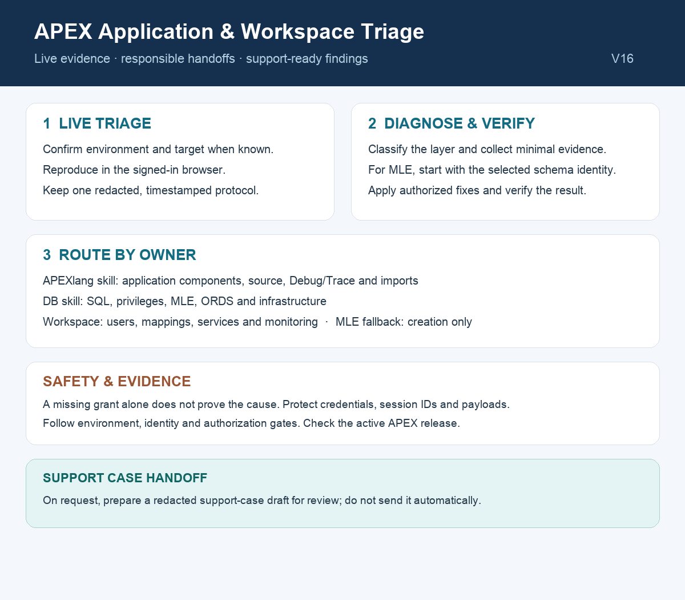

# Oracle APEX Workspace & Debugging Skill

This repository contains the `workspace-debugging` Agent Skill for Oracle APEX Workspace administration, health checks, and live browser triage of APEX applications. It provides operational guardrails, routing guidance, references, and a checklist planner for Workspace lifecycle and administration. The planner does not connect to APEX or execute its generated SQL.

It works alongside the APEXlang and DB skills, with each skill keeping its own domain.

The `apex/workspace-debugging/` path is prepared for placement alongside `apex/apexlang/` in a shared skills repository. That integration requires updating the shared `apex/SKILL.md` router; this standalone repository does not replace it.

The original APEXlang skill is the designated skill for APEX application source, component, Debug/Trace, and artifact work. Use it for those tasks whenever it is available in the active environment. Live browser reproduction and observation are covered here.

**Recommendation:** Prefer the APEXlang and DB skills for their respective application and database workflows. If either skill is unavailable, continue with the capabilities included here: live browser triage and, for MLE creation `ORA-01031`, the narrow SQLcl MCP fallback. State any remaining work that those capabilities cannot cover.

The APEXlang skill focuses on application development and also analyzes runtime
errors and verifies UI behavior. The Workspace Debugging skill starts with a
reported issue in a running app, reproduces it in the existing browser session,
and collects redacted evidence. It involves the APEXlang skill for component or
debug-log analysis and the DB skill for database analysis when needed. Both
skills support browser-based runtime checks. See the [case comparison](#implemented-diagnostic-cases-and-skill-boundaries)
for their boundaries.

## What It Provides

<table>
  <tr>
    <td width="42%" valign="top">
      <a href="docs/apex-workspace-application-triage-v16.png"></a>
    </td>
    <td width="58%" valign="top">
      <ul>
        <li>Live APEX application browser debugging in an already-signed-in browser session: reproduce runtime behavior, inspect visible errors, available console messages, and redacted request metadata. Application source/component diagnosis and APEX Debug/Trace analysis stay in APEXlang.</li>
        <li>Guided diagnosis and authorized fixes: use local cases and collaborate with APEXlang or DB as needed. Begin MLE privilege checks with the selected Workspace schema user; use an administrative connection later when needed. A narrow MLE creation fallback is available when DB is unavailable.</li>
        <li>Workspace lifecycle planning, inventory, verification, approved schema mappings, APEX user administration, recovery, and removal safeguards.</li>
        <li>Workspace dashboards and Monitor Activity, workspace service settings and requests, activity trends, active-session inventory, login attempts, file utilization, and Workspace health checks.</li>
        <li>Workspace administration UI checks and Workspace-scoped AI token-limit checks for supported APEX environments.</li>
        <li>Local protocol-file guidance for Workspace changes, administration checks, customer evidence, and live browser triage.</li>
        <li>Version-aware checks for supported APEX releases and runtime discovery of version-sensitive APIs, views, columns, and package signatures.</li>
        <li>Reviewable, redacted support-case drafts from existing investigation evidence.</li>
      </ul>
      <p>The included workspace planner is an optional helper. It does not execute SQLcl, ORDS, generic database administration, or customer-specific workflows.</p>
    </td>
  </tr>
</table>

[Read the accessible text version](docs/apex-workspace-application-triage-v16.md), including the [MLE grant debugging case](apex/workspace-debugging/application/mle-grant-debug.md), its [SQLcl MCP fallback](apex/workspace-debugging/application/mle-privilege-fallback.md), and the [support-case handoff](apex/workspace-debugging/references/diagnostics/support-case-handoff.md).

## Scope Boundaries

This skill owns APEX Workspace administration and live browser triage, plus the narrow MLE creation privilege fallback when the DB skill is unavailable. It does not:

- Generate or materially modify APEX application artifacts.
- Perform generic SQL/PLSQL, database schema/user, grant, quota, tablespace, backup, recovery, SQL tuning, AWR/ASH, SQL Monitor, ORDS, or infrastructure work.
- Query or modify internal APEX repository tables as a shortcut.
- Create logging tables, protocol tables, triggers, packages, instrumentation, or other database objects for skill operation.
- Store customer exports, reports, logs, screenshots, HAR files, or derived evidence in the repository by default; honor an explicit user-selected output path.

This repository handles APEX Workspace administration, Workspace-level reports, and live browser triage of APEX runtime behavior. Application source/export inspection, component/code diagnosis, APEX Debug/Trace analysis, generation, and artifact changes belong to the APEXlang skill. General database accounts, schemas, grants, SQL, performance, database security/migration, and ORDS work belong to the DB skill. For an MLE creation `ORA-01031`, the bundled fallback checks and, when authorized, repairs the specific missing MLE privilege via SQLcl MCP if the DB skill cannot be found.

## Route by Owner

### Cross-Skill Collaboration

The companion domain `SKILL.md` files are authoritative:

- APEX application development: `apex/SKILL.md`
- Generic Oracle Database and related database operations: `db/SKILL.md`

Before maintaining this repository, compare the proposed capability with those source skills. Reuse their workflows by reference and handoff; the MLE creation privilege fallback is the documented, narrowly scoped exception when the DB skill is unavailable.

Announce a handoff to a companion skill and apply its own `SKILL.md`, references, identity rules, connection, and confirmation gates. An explicit user request for the relevant application or DB diagnosis or repair already authorizes the handoff; do not ask for the same authorization again. Connections and privileges must not be silently reused across skills. Live browser triage stays in this skill while it is limited to reproducing and observing runtime behavior in the authenticated browser.

If the original APEXlang skill is not in the active catalog, check configured skill roots and actual local paths already supplied or discovered in the session. If it cannot be found, pause source/component/Debug-message work and ask the customer to install/activate it or provide its existing local `SKILL.md` path. Continue independent Workspace tasks, bounded live browser triage, and separately authorized DB diagnosis when possible; do not recreate APEXlang procedures here.

Example announcements:

```text
APEXlang skill handoff: `apex/SKILL.md` owns this APEX application source, component, Debug/Trace, or artifact work. Continue within the user's authorized scope.
```

```text
DB skill handoff: `db/SKILL.md` owns this database, SQL, performance, ORDS, schema, or privilege work. Continue within the user's authorized scope using the selected connection.
```

## Roles and Identity Model

The skill distinguishes the following identities; they are not interchangeable:

- APEX instance administrator for APEX Administration Services and the `INTERNAL` workspace.
- Dedicated database account with `APEX_ADMINISTRATOR_ROLE` for routine instance-level APEX administration.
- Workspace administrator or developer for workspace-scoped UI work.
- Application parsing schema and application database-login user.
- ORDS/APEX runtime account.
- Database administrator or diagnostic/performance identity owned by the DB/ORDS skills.

Routine live APEX administration uses a confirmed, dedicated non-`SYS`/`SYSTEM` APEX admin identity whenever available. The active identity is verified with `SESSION_USER`, `CURRENT_USER`, and `ISDBA` before live MCP-backed APEX queries or changes.

Routine APEX administration is blocked for `SYS`, `SYSDBA`, `ISDBA = TRUE`, parsing schemas, workspace schemas, workspace users, ORDS/APEX runtime accounts, generic deployment users, and unknown identities.

`SYSTEM` is an explicit exception only for APEX-admin-scoped work, without `SYSDBA`, after identity verification, visible scope and risk details, safe password handling, and a fresh reply of exactly `YES` in uppercase. Passwords are never requested or printed in chat, scripts, SQL text, protocol files, or logged tool calls.

## Evidence and Output Handling

- File-only analysis explicitly states when no database access is needed.
- For Workspace administration checks, the skill asks for the relevant Monitor Activity report, active-session status, or a redacted screenshot of the Workspace administration UI.
- The local operating-system Downloads folder is always a valid external location for customer-specific Workspace reports, protocols, and checklists. If it is used as the default location, ask for a fresh one-word `Ja` confirmation; accept only that location confirmation for the path, not for the underlying APEX action.
- Customer-specific reports require a user-confirmed output path before writing; prefer a location outside the repository unless the user explicitly selects another location. The Downloads rule satisfies the location requirement after the fresh `Ja` confirmation.
- Substantive Workspace checks and state changes require a local protocol file outside the skill tree.
- Live browser triage uses the separate redacted protocol described in `apex/workspace-debugging/references/diagnostics/live-browser-debugging.md`.
- Use one redacted protocol per execution, with the local start date and time at the end of its filename, for example `apex-app107-seite301-YYYYMMDD-HHMMSS.md`. Update that file across diagnosis, handoffs, approval, repair, and verification; use a new file for a separate execution. Protocols record scope, identity category, actions, observations, evidence references, handoffs, and final status while redacting secrets and sensitive payloads.
- Large artifacts remain local; responses use focused excerpts and compact summaries to reduce token usage.

## Supported Versions

The skill uses Oracle APEX 26.2 documentation as its primary reference and supports APEX 26.2, 26.1, 24.2, and 24.1 as defined by the skill's version gate. Version-sensitive APIs, views, columns, and arguments are checked against the target instance when live access is available.

## Repository Layout

```text
apex/workspace-debugging/
├── SKILL.md
├── references/
│   ├── diagnostics/
│   ├── monitoring/
│   ├── security/
│   └── workspace/
└── tools/
```

Load only the routed reference needed for the current task. Do not treat this README as a replacement for `apex/workspace-debugging/SKILL.md` or the routed references.

## Support Case Handoff

When an investigation stalls or the user requests an escalation summary, the
skill can prepare a copy-ready, redacted support-case draft from the evidence
already collected. It distinguishes verified facts, hypotheses, unknowns, and
unperformed checks; includes reproduction steps and relevant changes; and asks
for the specific support needed. It does not run additional checks just to fill
the template or submit the case automatically. A separate skill-improvement
feedback draft is available only when requested.

Example prompt:

```text
I cannot make further progress with this APEX issue. Prepare a redacted support
case from our investigation, including reproduction steps, evidence, completed
checks and changes, and open questions. Show me the draft for review; do not
submit it.
```

See [support-case-handoff.md](apex/workspace-debugging/references/diagnostics/support-case-handoff.md)
for the draft structure and evidence boundaries.

## Demo Prompts

### Debugging Demo 1: MLE Modules Debugging

<a href="docs/demo-1-mle-grants.png"></a>


**Fehlerfall simulieren:** In einer isolierten Entwicklungsumgebung können die
folgenden Rechte vor der Demo entzogen werden. Die Befehle betreffen das gesamte
Schema `ORACLE`; sie setzen voraus, dass die Rechte direkt an dieses Schema
vergeben wurden. Abweichende Schema-Namen und über Rollen vergebene Rechte sind
gesondert zu prüfen. Das Entziehen dieser Rechte allein garantiert keinen
`ORA-01031` beim Erstellen eines MLE-Moduls; die tatsächlich benötigten und
wirksamen Rechte hängen von der ausführenden Identität und dem Vorgang ab.

**Direkte Systemprivilegien prüfen:**
<pre style="font-size: 70%"><code>
-- Direkte Systemprivilegien für ORACLE
SELECT username, privilege, admin_option
FROM   user_sys_privs
WHERE  privilege IN ('CREATE MLE', 'EXECUTE DYNAMIC MLE')
ORDER BY privilege;

-- Als SYS AS SYSDBA ausführen
REVOKE EXECUTE DYNAMIC MLE FROM ORACLE;
REVOKE EXECUTE ON JAVASCRIPT FROM ORACLE;

-- Als entsprechend berechtigter Datenbankadministrator ausführen
GRANT EXECUTE DYNAMIC MLE TO ORACLE;
GRANT EXECUTE ON JAVASCRIPT TO ORACLE;
</code></pre>

`EXECUTE DYNAMIC MLE` ist für dynamische MLE-Ausführung erforderlich; für das
Erstellen eines MLE-Moduls ist unter anderem `CREATE MLE` relevant. Welche
Rechte konkret fehlen, hängt vom Vorgang und der ausführenden Identität ab.
Siehe [Oracle-Dokumentation zu MLE-Rechten](https://docs.oracle.com/en/database/oracle/oracle-database/26/adfns/application-architecture.html).

**Vorbereitung:** Öffne im integrierten VS-Code-Browser den APEX App Builder und
die Install Summary von App 100. Bleibe auf der Seite stehen, auf der das Skript
`MLE objects` mit dem Fehler `ORA-01031` angezeigt wird. Starte den Prompt,
bevor du die Installation erneut ausführst oder die Rechte änderst.

```text

Nutze den Workspace-Debugging-Skill und beginne beim sichtbaren ORA-01031
auf Seite 301 der APEX App 107 im VS-Code-Browser. Frage mich zuerst per
Auswahl nach der Umgebung: lokale Entwicklung, Test oder Produktion.

Debugge live und prüfe mit dem DB-Skill über SQLcl-MCP lesend den
Ausführungskontext und die benötigten MLE-Rechte. Frage bei Bedarf nach
einer administrativen Verbindung. Nutze keinen SQL Workshop.

Berichte den Befund und den kleinsten begründeten Lösungsvorschlag.
Führe keine Änderungen aus und warte auf meine Freigabe. Schreibe ein
redigiertes Protokoll nach .logs.

```

### Debugging Demo 2: Laufstatistik – JSON.WRITER.CLOSE_OBJECT

<a href="docs/demo-2-table-missing.png"></a>

**Vorbereitung:** Importiere die vorbereitete Seite 302 in App 107 und öffne sie
im integrierten VS-Code-Browser. Bleibe beim sichtbaren Fehler stehen und starte
von dort den Prompt. Für die Demo muss die vorbereitete fehlerhafte Abfrage in
der installierten App vorhanden sein. Der Prompt verrät die Ursache nicht.

```text
Nutze den Workspace-Debugging-Skill und beginne beim angezeigten Fehler der
App 107 auf Seite 302 im geöffneten VS-Code-Browser. Frage mich zuerst
über die Auswahl nach der Umgebung: lokale Entwicklung, Test oder Produktion.

Debugge die laufende Anwendung live. Untersuche die sichtbare Fehlermeldung
einschließlich eines möglichen Hinweises auf JSON.WRITER.CLOSE_OBJECT, gehe
durch die betroffene Seite und ermittle die eigentliche Ursache. Prüfe die
installierte App und ihre Komponenten; untersuche keine lokalen APEXlang-Dateien.
Nutze APEXlang für die Komponenten- und Debug-Analyse und bei Bedarf den DB-Skill
über SQLcl-MCP für lesende Datenbankprüfungen. Nutze keinen SQL Workshop.

Berichte den Befund und schlage die kleinste passende Behebung vor. Warte auf
meine Freigabe, bevor du etwas änderst. Behebe danach die bestätigte Ursache in
der App, wiederhole den betroffenen Ablauf live und prüfe das Ergebnis.
Schreibe ein redigiertes Protokoll nach .logs.
```

### Debugging Demo 3: APEX Debug Bench – Dynamic Action

<a href="docs/demo-3-dynamic-action.png"></a>

```text
Nutze den Workspace-Debugging-Skill und beginne bei der geöffneten APEX Debug Bench App 107 im VS-Code-Browser. Frage mich zuerst über die Auswahl nach der Umgebung: lokale Entwicklung, Test oder Produktion.

Debugge den angezeigten Seitenfehler live. Prüfe, warum der betroffene Button
oder die Aktualisierung des Seitenwerts nicht wie erwartet funktioniert. Nutze
für die Analyse der Seitenkomponenten und Dynamic Action den APEXlang-Skill.

Berichte den Befund und schlage die kleinste passende Behebung vor. Warte auf meine Freigabe, bevor du etwas änderst. Behebe danach die bestätigte Ursache, wiederhole den betroffenen Ablauf im APEX-Fenster und prüfe das Ergebnis.
Schreibe ein redigiertes Protokoll nach .logs.
```

### Demo-Fehler wiederherstellen

Die folgenden Schritte setzen die drei Fälle für eine erneute Demo zurück. Sie
gelten für eine isolierte lokale Entwicklungsumgebung und ändern die installierte
App 107 beziehungsweise die Rechte ihres ausführenden Schemas. Vor dem Zurücksetzen
Umgebung, Schema und aktuellen Zustand prüfen; die Änderungen bewusst freigeben.

1. **MLE-Rechte (Seite 301):** Die ausführende Identität und ihre wirksamen
   MLE-Rechte mit dem DB-Skill über SQLcl-MCP prüfen. Für den vorbereiteten Fall
   die oben unter Demo 1 aufgeführten direkten Grants `EXECUTE DYNAMIC MLE` und
   `EXECUTE ON JAVASCRIPT` für das betreffende Schema durch eine entsprechend
   berechtigte administrative Verbindung entziehen; die dort genannten
   Voraussetzungen beachten. Über Rollen oder andere Wege erhaltene Rechte können
   den Fehler weiterhin verhindern. Anschließend Seite 301 erneut ausführen und
   prüfen, ob der erwartete Rechtefehler erscheint.
2. **Fehlende Tabelle (Seite 302):** Im Page Designer der installierten App die
   Tabellenreferenz in der betroffenen Diagrammserien-Abfrage von `GARMIN` auf
   `GARMIN_MISSING_TABLE` ändern und speichern. Die tatsächliche Tabelle wird
   dabei nicht umbenannt. Die Seite neu laden und den Fehler prüfen.
3. **Dynamic Action (Seite 303):** In der Dynamic Action „Refresh Garmin Report“
   die Aktion „Absichtlicher Dynamic-Action-Benchmark-Fehler“ wieder aktivieren:
   die ausgeschlossene Build Option „Commented Out“ entfernen und speichern.
   Seite 303 neu laden und „Activity Type Report“ ändern. Der Report sollte sich
   aktualisieren und anschließend der absichtliche Fehler `ORA-20003` erscheinen.

Die zurückgesetzten Fehler bleiben für die Demo aktiv, bis sie erneut behoben
werden. Diese Schritte sind eine Anleitung und führen selbst keine Änderungen aus.

### Debugging Demo 4: APEX Benchmark Live Run
Open http://127.0.0.1:28443 in your browser. This non-production playground uses ChangeMe_VSCode_12345 for all logins.
```text
Ich bin nun auf der page 3 für den automatischen Benchmark Test. kannst du jetzt die applikation durchlaufen für die 3 usecases pro modell aus der Tabelle, auch bitte in der Reihenfolge, und diese jeweils als live browser asuführung bzw. meinen VSCode nutzen zur Umschaltung der modelle. die Fehler dürfen nicht gefixt werden, sondern sie sollen nur festgestellt werden und dann zum nächste testcase.
```

# IMPORTANT TO READ
I accept no liability for the use of this skill; it supports only officially supported Oracle APEX versions and invokes or uses only original, documented Oracle APEX functionality.

## Implemented Diagnostic Cases and Skill Boundaries

The following describes the workflows and diagnostic patterns implemented in this
repository. A **triage** entry means the Workspace skill can collect and classify
the permitted evidence independently; it does not guarantee that the root cause
can be confirmed or fixed without another skill. Browser observations depend on
the available tool's actual console and network capabilities. The patterns are
hypotheses and routing guidance, not automated fixes or proof that every case has
been tested end to end.

| Case | What the Workspace skill can do without APEXlang or the DB skill | Can APEXlang also handle it? |
| --- | --- | --- |
| Page does not load, redirects, renders incorrectly, or a Builder page cannot be opened | Reproduce or observe in the existing signed-in browser; record the error and compare the available app, page, environment and working-copy context. Component, template and import investigation requires APEXlang. | **Partly.** APEXlang has runtime UI verification and component/import diagnostics; its UI workflow focuses on defects remaining after successful validate/import. |
| Button, page item, Dynamic Action, report/grid refresh or AJAX fails | Observe the smallest safe interaction and capture visible results and available redacted request metadata. Item submission, action definitions, conditions and application changes require APEXlang. | **Yes, for application diagnosis and repair.** APEXlang covers Dynamic Actions and correlation of runtime errors with APEX debug logs. |
| `JSON.WRITER.CLOSE_OBJECT`, empty chart or chart SQL error | Observe the chart and the visible/request symptom. Do not infer a missing table or the root cause from the message alone. The installed series and APEX Debug/Trace belong to APEXlang; database object or privilege checks belong to DB. | **Yes, for chart components and APEX debug analysis.** Database causes may also need DB. |
| Browser JavaScript exception, blocked asset, CORS or mixed-content error | Capture the concise console message and redacted request metadata if the browser tool exposes them; classify the failing layer. Application code/assets, ORDS and network causes need the relevant owner. | **Partly.** APEXlang can investigate application code and has a separate runtime UI workflow; infrastructure remains outside its application scope. |
| REST or external-call failure | Record the visible result and available redacted endpoint shape, status and timing. Application call configuration belongs to APEXlang; ORDS, ACL and infrastructure work belongs to DB or the responsible owner. | **Partly.** APEXlang can investigate the application call and correlated debug evidence; it does not replace infrastructure diagnosis. |
| Slow page or application error | Use the appropriate Workspace dashboard or report to locate the affected page/time window, and collect available browser timing or visible error evidence. Those observations do not establish a SQL or component root cause. Live Workspace checks require the documented identity and access gates. | **Partly.** APEXlang handles application and APEX debug analysis; Workspace monitoring and database performance work have separate owners. |
| Login, role or access differs between users | Record the visible symptom and user type; use the Workspace account and monitoring workflows for Workspace users/groups within their documented scope. Application authorization, database access and SSO belong to their respective owners. | **Partly.** APEXlang can investigate application authorization and components; it does not replace Workspace user administration or identity-provider investigation. |
| `ORA-01031` creating an MLE module or environment | Independently perform browser triage. If the DB skill is unavailable, the narrowly scoped SQLcl MCP fallback can check relevant creation privileges and, only when the missing right, recipient and target are verified and repair is authorized, apply the minimal grant and verify it. The fallback requires SQLcl MCP and database access; it is not an offline workflow. | **Partly.** APEXlang can investigate import/application and debug evidence; privilege diagnosis and grants belong to DB, or to this specific creation fallback when DB is unavailable. |
| `ORA-01031` executing MLE or dynamic JavaScript | Observe the failure and identify the visible operation. Effective execution privileges and grants require DB; the creation fallback does **not** cover runtime or dynamic MLE. | **Partly.** APEXlang can identify the application action and debug evidence; execution privilege work belongs to DB. |
| `ORA-00942`, object access or definer-rights failure | Capture the visible error and context. Determining object resolution, effective identity, synonyms and access requires DB; source and debug analysis requires APEXlang. | **Partly.** APEXlang can identify the component and SQL from debug evidence; database object and privilege checks belong to DB. |
| Checksum/session-state protection, incomplete Supporting Objects, export/installed-app mismatch or version incompatibility | Capture visible symptoms and target context and route the case. Do not disable security, retry installation, or infer a source-level defect from browser evidence alone. | **Yes, for the corresponding application, import and validation analysis.** Database and infrastructure causes may need DB. |

**Live debugging overlap:** This Workspace skill provides a general live-browser
triage workflow for an existing authenticated session, including the VS Code
embedded browser fallback, evidence redaction and handoff. The inspected
APEXlang skill also documents live runtime UI verification: opening a page,
capturing a snapshot, interacting with controls and retesting after a fix. It
also documents `APEX_DEBUG_MESSAGES` analysis. Therefore live browser work is
not exclusive to this skill; the workflows have different entry points and
overlap for runtime UI behavior. See [live browser debugging](apex/workspace-debugging/references/diagnostics/live-browser-debugging.md),
the [triage matrix](apex/workspace-debugging/application/triage-matrix.md) and
the [diagnostic patterns](apex/workspace-debugging/application/diagnostic-patterns.md).
