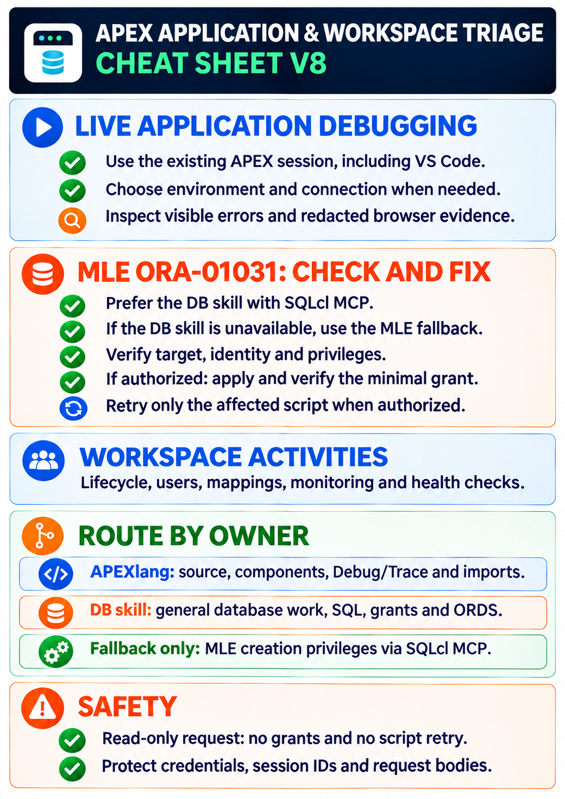

# Oracle APEX Workspace & Debugging Skill

This repository contains the `workspace-debugging` Agent Skill for Oracle APEX Workspace administration, health checks, and live browser triage of APEX applications. It provides operational guardrails, routing guidance, references, and a checklist planner for Workspace lifecycle and administration. The planner does not connect to APEX or execute its generated SQL.

It works alongside the APEXlang and DB skills, with each skill keeping its own domain.

The `apex/workspace-debugging/` path is prepared for placement alongside `apex/apexlang/` in a shared skills repository. That integration requires updating the shared `apex/SKILL.md` router; this standalone repository does not replace it.

The original APEXlang skill is the designated skill for APEX application source, component, Debug/Trace, and artifact work. Use it for those tasks whenever it is available in the active environment. Live browser reproduction and observation are covered here.

**Recommendation:** Prefer the APEXlang and DB skills for their respective application and database workflows. If either skill is unavailable, continue with the capabilities included here: live browser triage and, for MLE creation `ORA-01031`, the narrow SQLcl MCP fallback. State any remaining work that those capabilities cannot cover.

## What It Provides

<table>
  <tr>
    <td width="42%" valign="top">
      <a href="docs/apex-workspace-application-triage-v8.png"></a>
    </td>
    <td width="58%" valign="top">
      <ul>
        <li>Live APEX application browser debugging in an already-signed-in browser session: reproduce runtime behavior, inspect visible errors, available console messages, and redacted request metadata. Application source/component diagnosis and APEX Debug/Trace analysis stay in APEXlang.</li>
        <li>Guided MLE ORA-01031 diagnosis and authorized minimal repair via SQLcl MCP: prefer the DB skill; if unavailable, use the bundled fallback for MLE creation privileges only.</li>
        <li>Workspace lifecycle planning, inventory, verification, approved schema mappings, APEX user administration, recovery, and removal safeguards.</li>
        <li>Workspace dashboards and Monitor Activity, workspace service settings and requests, activity trends, active-session inventory, login attempts, file utilization, and Workspace health checks.</li>
        <li>Workspace administration UI checks and Workspace-scoped AI token-limit checks for supported APEX environments.</li>
        <li>Local protocol-file guidance for Workspace changes, administration checks, customer evidence, and live browser triage.</li>
        <li>Version-aware checks for supported APEX releases and runtime discovery of version-sensitive APIs, views, columns, and package signatures.</li>
      </ul>
      <p>The included workspace planner is an optional helper. It does not execute SQLcl, ORDS, generic database administration, or customer-specific workflows.</p>
    </td>
  </tr>
</table>

[Read the accessible text version](docs/apex-workspace-application-triage-v8.md), including the [MLE grant debugging case](apex/workspace-debugging/application/mle-grant-debug.md) and its [SQLcl MCP fallback](apex/workspace-debugging/application/mle-privilege-fallback.md).

## Scope Boundaries

This skill owns APEX Workspace administration and live browser triage, plus the narrow MLE creation privilege fallback when the DB skill is unavailable. It does not:

- Generate or materially modify APEX application artifacts.
- Perform generic SQL/PLSQL, database schema/user, grant, quota, tablespace, backup, recovery, SQL tuning, AWR/ASH, SQL Monitor, ORDS, or infrastructure work.
- Query or modify internal APEX repository tables as a shortcut.
- Create logging tables, protocol tables, triggers, packages, instrumentation, or other database objects for skill operation.
- Store customer exports, reports, logs, screenshots, HAR files, or derived evidence in the repository by default; honor an explicit user-selected output path.

This repository handles APEX Workspace administration, Workspace-level reports, and live browser triage of APEX runtime behavior. Application source/export inspection, component/code diagnosis, APEX Debug/Trace analysis, generation, and artifact changes belong to the APEXlang skill. General database accounts, schemas, grants, SQL, performance, database security/migration, and ORDS work belong to the DB skill. For an MLE creation `ORA-01031`, the bundled fallback checks and, when authorized, repairs the specific missing MLE privilege via SQLcl MCP if the DB skill cannot be found.

## Route by Owner

### Cross-Skill Collaboration

The companion domain `SKILL.md` files are authoritative:

- APEX application development: `apex/SKILL.md`
- Generic Oracle Database and related database operations: `db/SKILL.md`

Before maintaining this repository, compare the proposed capability with those source skills. Reuse their workflows by reference and handoff; the MLE creation privilege fallback is the documented, narrowly scoped exception when the DB skill is unavailable.

Announce a handoff to a companion skill and apply its own `SKILL.md`, references, identity rules, connection, and confirmation gates. An explicit user request for the relevant application or DB diagnosis or repair already authorizes the handoff; do not ask for the same authorization again. Connections and privileges must not be silently reused across skills. Live browser triage stays in this skill while it is limited to reproducing and observing runtime behavior in the authenticated browser.

If the original APEXlang skill is not in the active catalog, check configured skill roots and actual local paths already supplied or discovered in the session. If it cannot be found, pause source/component/Debug-message work and ask the customer to install/activate it or provide its existing local `SKILL.md` path. Continue independent Workspace tasks, bounded live browser triage, and separately authorized DB diagnosis when possible; do not recreate APEXlang procedures here.

Example announcements:

```text
APEXlang skill handoff: `apex/SKILL.md` owns this APEX application source, component, Debug/Trace, or artifact work. Continue within the user's authorized scope.
```

```text
DB skill handoff: `db/SKILL.md` owns this database, SQL, performance, ORDS, schema, or privilege work. Continue within the user's authorized scope using the selected connection.
```

## Roles and Identity Model

The skill distinguishes the following identities; they are not interchangeable:

- APEX instance administrator for APEX Administration Services and the `INTERNAL` workspace.
- Dedicated database account with `APEX_ADMINISTRATOR_ROLE` for routine instance-level APEX administration.
- Workspace administrator or developer for workspace-scoped UI work.
- Application parsing schema and application database-login user.
- ORDS/APEX runtime account.
- Database administrator or diagnostic/performance identity owned by the DB/ORDS skills.

Routine live APEX administration uses a confirmed, dedicated non-`SYS`/`SYSTEM` APEX admin identity whenever available. The active identity is verified with `SESSION_USER`, `CURRENT_USER`, and `ISDBA` before live MCP-backed APEX queries or changes.

Routine APEX administration is blocked for `SYS`, `SYSDBA`, `ISDBA = TRUE`, parsing schemas, workspace schemas, workspace users, ORDS/APEX runtime accounts, generic deployment users, and unknown identities.

`SYSTEM` is an explicit exception only for APEX-admin-scoped work, without `SYSDBA`, after identity verification, visible scope and risk details, safe password handling, and a fresh reply of exactly `YES` in uppercase. Passwords are never requested or printed in chat, scripts, SQL text, protocol files, or logged tool calls.

## Evidence and Output Handling

- File-only analysis explicitly states when no database access is needed.
- For Workspace administration checks, the skill asks for the relevant Monitor Activity report, active-session status, or a redacted screenshot of the Workspace administration UI.
- The local operating-system Downloads folder is always a valid external location for customer-specific Workspace reports, protocols, and checklists. If it is used as the default location, ask for a fresh one-word `Ja` confirmation; accept only that location confirmation for the path, not for the underlying APEX action.
- Customer-specific reports require a user-confirmed output path before writing; prefer a location outside the repository unless the user explicitly selects another location. The Downloads rule satisfies the location requirement after the fresh `Ja` confirmation.
- Substantive Workspace checks and state changes require a local protocol file outside the skill tree.
- Live browser triage uses the separate redacted protocol described in `apex/workspace-debugging/references/diagnostics/live-browser-debugging.md`.
- Protocols record scope, identity category, actions, observations, evidence references, handoffs, and final status while redacting secrets and sensitive payloads.
- Large artifacts remain local; responses use focused excerpts and compact summaries to reduce token usage.

## Supported Versions

The skill uses Oracle APEX 26.2 documentation as its primary reference and supports APEX 26.2, 26.1, 24.2, and 24.1 as defined by the skill's version gate. Version-sensitive APIs, views, columns, and arguments are checked against the target instance when live access is available.

## Repository Layout

```text
apex/workspace-debugging/
├── SKILL.md
├── references/
│   ├── diagnostics/
│   ├── monitoring/
│   ├── security/
│   └── workspace/
└── tools/
```

Load only the routed reference needed for the current task. Do not treat this README as a replacement for `apex/workspace-debugging/SKILL.md` or the routed references.

## Demo Prompts

### Debugging Demo 1: MLE Modules Debugging

**Vorbereitung:** Öffne im integrierten VS-Code-Browser den APEX App Builder und
die Install Summary von App 100. Bleibe auf der Seite stehen, auf der das Skript
`MLE objects` mit dem Fehler `ORA-01031` angezeigt wird. Starte den Prompt,
bevor du die Installation erneut ausführst oder die Rechte änderst.

```text
Nutze den Workspace-Debugging-Skill und beginne beim angezeigten Fehler von APEX App 100
im geöffneten VS-Code-Browser. Frage mich zuerst über die Auswahl nach der
Umgebung: lokale Entwicklung, Test oder Produktion.

Debugge anschließend live und ermittle mit dem DB-Skill über SQLcl-MCP zunächst
lesend die tatsächliche DDL-Identität und deren benötigte MLE-Rechte. Nutze
keinen SQL Workshop.

Berichte den Befund und den kleinsten nötigen Grant-Vorschlag. Warte auf meine
Freigabe, bevor du etwas änderst. Behebe danach die Ursache über SQLcl-MCP,
wiederhole die Installation der Supporting Objects im APEX-Fenster und prüfe
das Ergebnis. Schreibe ein redigiertes Protokoll nach .logs.
```

### Debugging Demo 2: Garmin App – JSON.WRITER.CLOSE_OBJECT

**Vorbereitung:** Öffne die Garmin-App 106 im integrierten VS-Code-Browser und
rufe Seite 1 auf. Bleibe bei der angezeigten Fehlermeldung stehen und starte
von dort den Prompt. Für die Demo muss die vorbereitete fehlerhafte Abfrage in
der installierten App vorhanden sein. Der Prompt verrät die Ursache nicht.

```text
Nutze den Workspace-Debugging-Skill und beginne beim angezeigten Fehler der
Garmin-App 106 auf Seite 1 im geöffneten VS-Code-Browser. Frage mich zuerst
über die Auswahl nach der Umgebung: lokale Entwicklung, Test oder Produktion.

Debugge die laufende Anwendung live. Untersuche die sichtbare Fehlermeldung
einschließlich eines möglichen Hinweises auf JSON.WRITER.CLOSE_OBJECT, gehe
durch die betroffene Seite und ermittle die eigentliche Ursache. Prüfe die
installierte App und ihre Komponenten; untersuche keine lokalen APEXlang-Dateien.
Nutze APEXlang für die Komponenten- und Debug-Analyse und bei Bedarf den DB-Skill
über SQLcl-MCP für lesende Datenbankprüfungen. Nutze keinen SQL Workshop.

Berichte den Befund und schlage die kleinste passende Behebung vor. Warte auf
meine Freigabe, bevor du etwas änderst. Behebe danach die bestätigte Ursache in
der App, wiederhole den betroffenen Ablauf live und prüfe das Ergebnis.
Schreibe ein redigiertes Protokoll nach .logs.
```

### Debugging Demo 3: APEX Debug Bench – Dynamic Action

```text
Nutze den Workspace-Debugging-Skill und beginne bei der geöffneten APEX Debug Bench App 107
im VS-Code-Browser. Frage mich zuerst über die Auswahl nach der Umgebung: lokale
Entwicklung, Test oder Produktion.

Debugge den angezeigten Seitenfehler live. Prüfe, warum der betroffene Button
oder die Aktualisierung des Seitenwerts nicht wie erwartet funktioniert. Nutze
für die Analyse der Seitenkomponenten und Dynamic Action den APEXlang-Skill.

Berichte den Befund und schlage die kleinste passende Behebung vor. Warte auf
meine Freigabe, bevor du etwas änderst. Behebe danach die bestätigte Ursache,
wiederhole den betroffenen Ablauf im APEX-Fenster und prüfe das Ergebnis.
Schreibe ein redigiertes Protokoll nach .logs.
```

# IMPORTANT TO READ
I accept no liability for the use of this skill; it supports only officially supported Oracle APEX versions and invokes or uses only original, documented Oracle APEX functionality.
